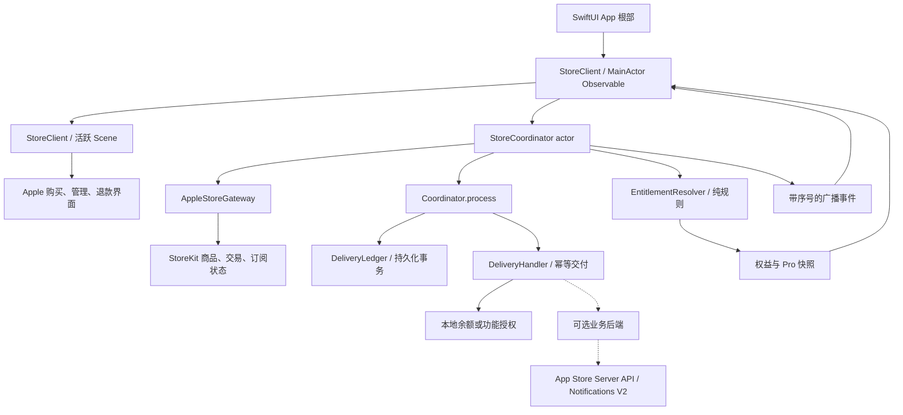
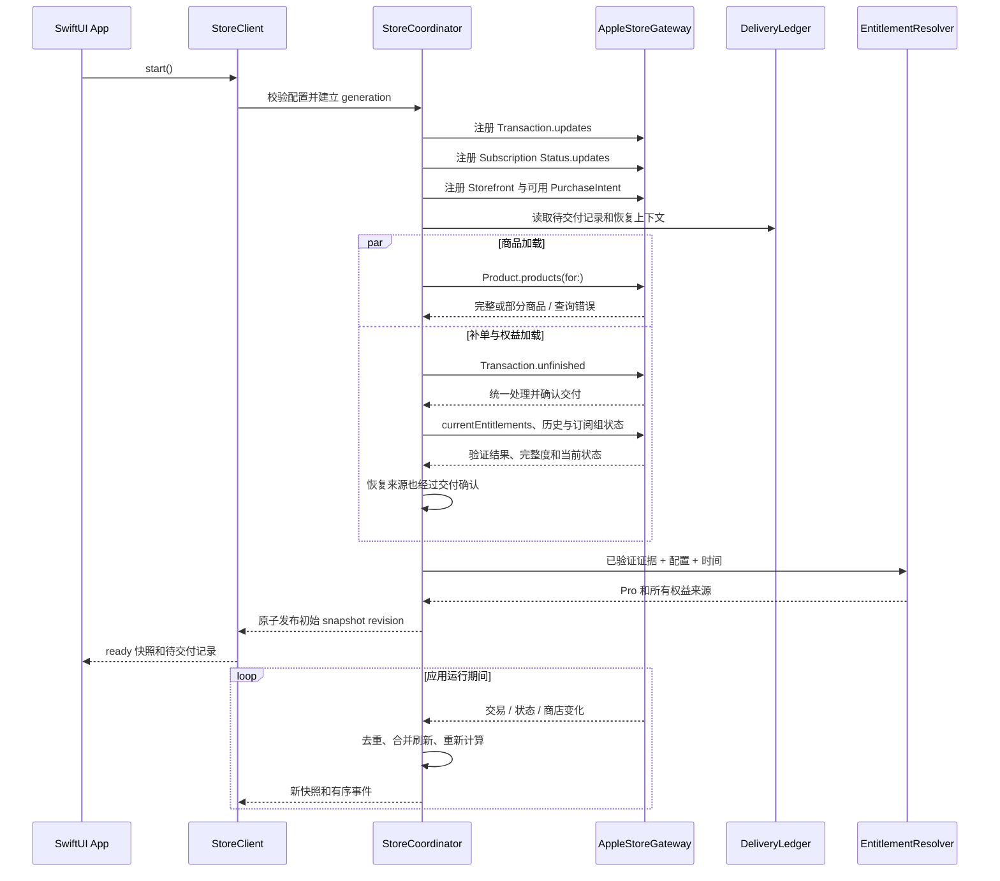
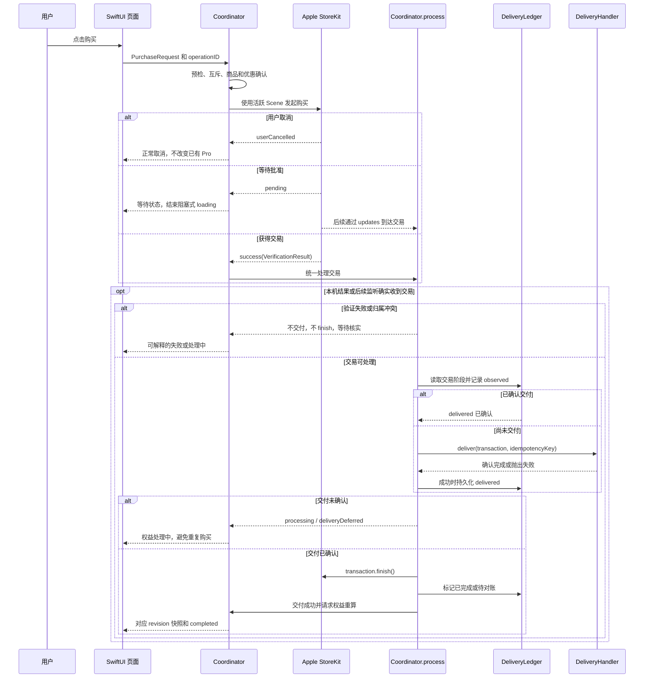
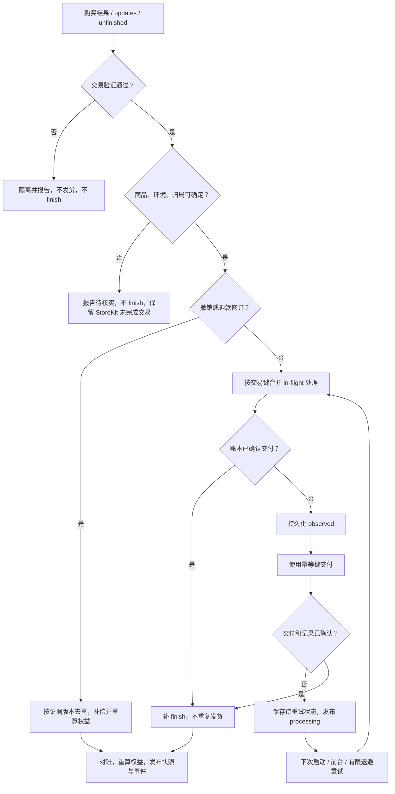
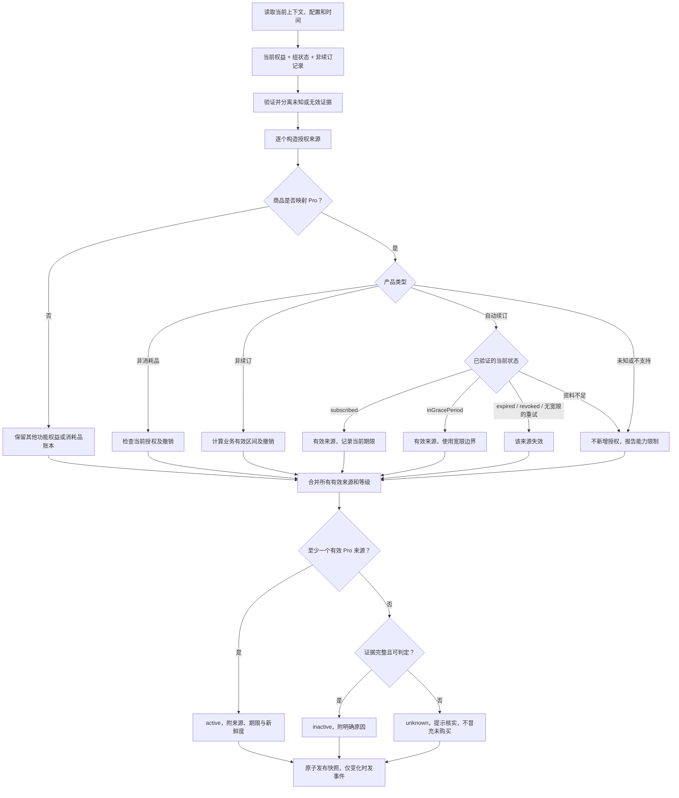
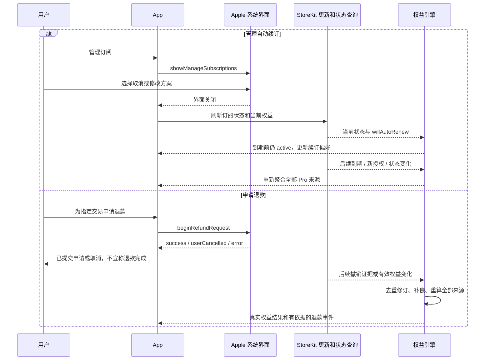
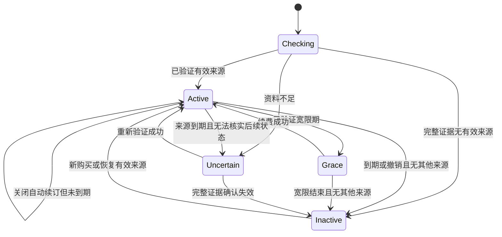
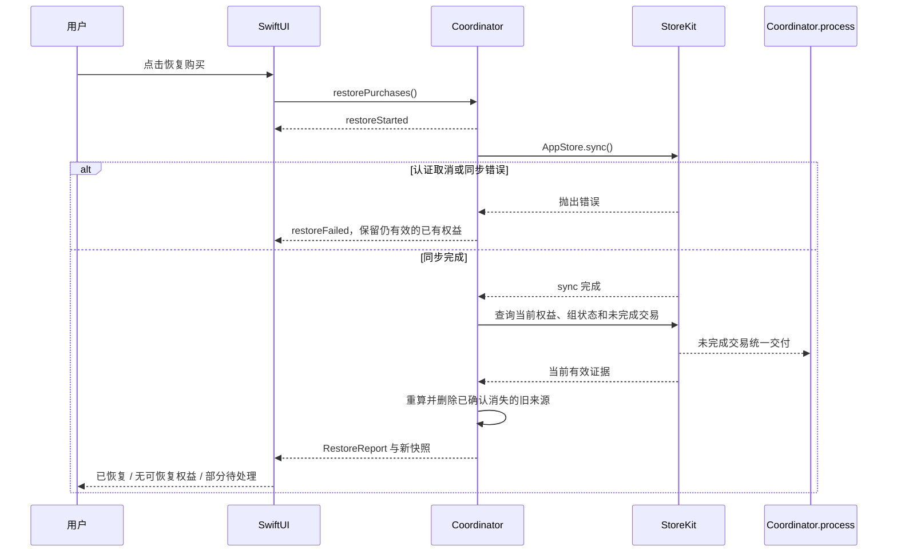

# Swift 6 StoreKit 2 时序图与流程图

> 与 StoreKitFlow 2.0 实现对齐的业务流程。交易处理器实际位于 StoreCoordinator 内，Scene 入口位于 StoreClient；图中的模块框表示职责。最终 API 见 [接入文档](StoreKitFlow-接入与业务规则.md)。

## 1. 模块架构

[查看 SVG](Diagrams/01-architecture.svg)

核心不依赖 SwiftUI。图中后端为可选生产集成，领域测试使用 Fake 交付器验证契约，示例默认不访问业务后端。

## 2. 初始化与恢复时序

[查看 SVG](Diagrams/02-initialization.svg)

监听先于扫描，来自扫描和监听的同一交易可能并发到达，必须合并。启动不调用 `AppStore.sync()`；商品目录失败不能阻断已有 Pro 的读取。

## 3. 购买与交付时序

[查看 SVG](Diagrams/03-purchase.svg)

图中 pending 后续处理是未来事件，不要求购买调用一直等待。用户取消分支无交易，不执行后续交付。外部服务交付和本地记录之间的中断，依靠相同幂等键恢复，不承诺分布式 exactly-once。

## 4. 统一交易处理流程

[查看 SVG](Diagrams/04-transaction-processing.svg)

持久化 observed 失败时直接进入待恢复错误，不继续交付。对于修订事件，是否需要完成对应 unfinished 交易由处理器检查；不能把退款修订当作新的正向发货。

## 5. Pro 判定流程

[查看 SVG](Diagrams/05-pro-resolution.svg)

`willAutoRenew=false` 不进入“该来源失效”分支。一个订阅退款也不能覆盖另一个有效的终身或家庭共享来源。恢复失败与完整扫描得到空结果必须区分。

## 6. 取消自动续订与退款时序

[查看 SVG](Diagrams/06-cancellation-refund.svg)

提交退款与审批结果之间没有固定完成时限；离线或 App 挂起时后续变化可能到下次刷新才观察到。没有足够原因信息时只能报告撤销，不能冒充知道退款审理结果。

## 7. 订阅状态与 Pro 的关系

[查看 SVG](Diagrams/07-subscription-state.svg)

此图表示聚合后的访问状态示意，不是 Apple 枚举的一对一复制。Grace 提供访问权限；Inactive 可附 expired、revoked、billingRetry 等原因；多个来源并存时只有全部失效才关闭 Pro。

## 8. 用户恢复购买时序

[查看 SVG](Diagrams/08-restore.svg)

恢复购买不重发已经消费的金币，不保证恢复另一个自有账户的订单；严格账号模式下必须先核实归属。
